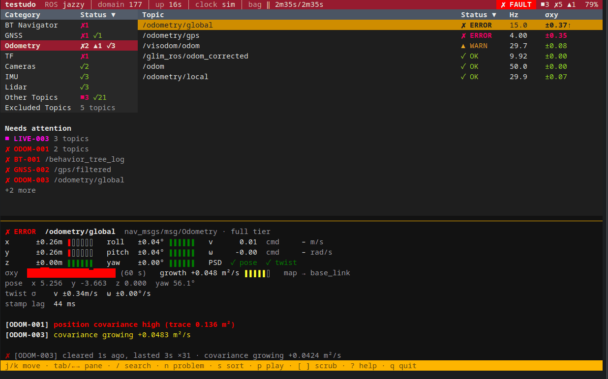

<p align="center">
  
</p>

**Black-box diagnostics for ROS 2 navigation stacks — neofetch for your nav stack.**

Testudo watches a running robot from the outside, with no changes to its
nodes. It checks every topic's health (is it alive, at the right rate),
what the sensors and odometry actually report (covariance, stuck or
invalid readings, frame ids), the TF tree, and Nav2's goals and behavior
tree. Results show up in a live terminal dashboard and on standard
`diagnostic_msgs/DiagnosticArray` topics you can plot in PlotJuggler or
Foxglove.

<p align="center">
  
</p>

## What it does

- **Every topic, cheaply.** Undeclared topics get liveness and rate
  checks from raw subscriptions; topics you declare get full content
  checks from a plugin (localization, IMU, GNSS, lidar, cameras, TF, Nav2
  actions, behavior tree).
- **Quiet is not dead.** Latched topics, event-driven ones (paths, action
  feedback, costmap updates) and inputs nobody is driving right now are
  told apart from a publisher that died.
- **A dashboard you read at a glance.** Categories, their topics and the
  highlighted topic's detail are all on screen at once, with a "Needs
  attention" list, `n` to jump to the next problem, and a history of
  faults that came and went.
- **Live, headless, or from a bag.** `watch` for the dashboard, `watch
  --headless` (or the launch file) on a robot, `replay` for a recorded bag:
  a report, or the dashboard to play back and scrub.
- **Extensible.** Checks are plugins behind one small interface; the
  built-in ones use the same interface yours would.

<p align="center">
  
</p>

## Install

ROS 2 Humble or newer (developed on Jazzy), Python 3.10+.

```bash
cd ~/your_ws/src
git clone git@github.com:mlisi1/testudo.git
cd ~/your_ws
rosdep install --from-paths src --ignore-src -r -y
pip install textual   # rosdep's python3-textual is too old for the TUI
colcon build --packages-select testudo
source install/setup.bash
```

## Quick start

```bash
testudo watch                    # live dashboard (? for keys, q to quit)
testudo watch --headless         # same checks, no TUI: publishes until Ctrl-C
testudo replay my_bag/           # report over a bag; exit code 0 OK, 1 WARN, 2 ERROR
testudo replay --watch my_bag/   # play the bag back in the dashboard ([ ] to scrub, p to play)
testudo plugins                  # which checks exist, and what they cover

# In a simulator, or from a launch file:
testudo watch --ros-args -p use_sim_time:=true
ros2 launch testudo testudo.launch.py config:=/path/to/testudo.yaml use_sim_time:=true
```

With no config, Testudo watches every topic at the cheap tier. Declare the
topics you care about in `~/.config/testudo/config.yaml` (or pass `-c`) to
get their content checks:

```yaml
topics:
  nav_msgs/msg/Odometry:
    - name: /odom
      thresholds:
        position_covariance_trace: {green: 0.02, orange: 0.2}
  sensor_msgs/msg/Imu:
    - name: /imu/data

actions:
  - name: navigate_to_pose

tf:
  - {parent: map, child: base_link}
```

[`config/example_config.yaml`](config/example_config.yaml) is a complete,
commented reference.

## Output

| Topic | What's on it |
|---|---|
| `/testudo/<plugin>` | one status per topic that plugin checks, e.g. `/testudo/localization` |
| `/testudo/vitals` | topics no plugin checks (rate, age, liveness) |
| `/testudo/overall` | the roll-up verdict |
| `/testudo/faults` | one status per fault, active or cleared: plot when each was active |
| `/testudo/nodes` | CPU, memory and GPU per node |

Values are plain numbers with the unit in the key (`rate_hz`,
`duration_s`), ready to plot. `publish: {per_plugin: false}` puts
everything on `/diagnostics` instead, for rqt_robot_monitor.

## Documentation

Configuration in depth, the output schema, writing your own check plugin:
the full documentation is being written in [`docs/`](docs/).

## License

Apache License 2.0 — see [LICENSE](LICENSE).
