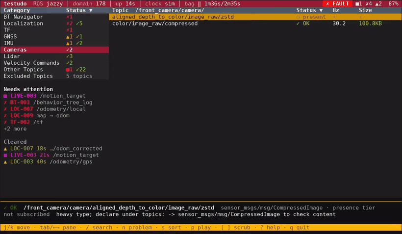

<p align="center">
  
</p>

<h3 align="center">Is my nav stack healthy right now?<br>And if not, what broke first?</h3>

<p align="center">
  <a href="https://mlisi1.github.io/testudo/">Documentation</a> ·
  <a href="https://mlisi1.github.io/testudo/getting-started/">Getting started</a> ·
  <a href="https://mlisi1.github.io/testudo/tui/explore/">Try the dashboard in your browser</a>
</p>

<p align="center">
  
</p>

Testudo is a diagnostics dashboard for ROS 2 navigation stacks. It watches every topic from the outside, judges what it sees, and points you at the problem, live in your terminal or from a recorded bag.

- **No changes to your nodes.** Point it at a running graph and it finds the topics and matches their QoS.
- **No config needed.** Every topic a plugin understands is checked as soon as it appears.
- **Quiet is not dead.** Latched topics, on-demand topics and idle inputs are told apart from a publisher that died.
- **Every problem explained.** Each code has an entry with its likely causes and what to do.
- **Built for Nav2, not tied to it.** Only the behavior tree log and Nav2's expected rates need Nav2.

## Why Testudo

A navigation stack rarely fails loudly. The robot stops short, drifts, or spins in place, while every node is up and every topic is publishing. The fault is in the data: a covariance left at a placeholder, an IMU in the wrong units, a transform with two parents.

| Tool | What it gives you | What's left to you |
|---|---|---|
| `ros2 topic hz`, `echo` | One topic at a time | Choosing the topic and judging the numbers |
| `rqt_robot_monitor` | What nodes report about themselves | Everything they don't report |
| Foxglove, PlotJuggler | Every signal, plotted | Knowing which signal matters |
| **Testudo** | **Every topic at once, already judged** | **Fixing the cause** |

## Quick start

### 1. Install

Testudo is a colcon package for ROS 2 Jazzy.

```bash
source /opt/ros/jazzy/setup.bash
mkdir -p ~/your_ws/src && cd ~/your_ws/src
git clone https://github.com/mlisi1/testudo.git
cd ~/your_ws
rosdep update
rosdep install --from-paths src --ignore-src -r -y --skip-keys python3-textual
python3 -m pip install --user --break-system-packages textual
colcon build --packages-select testudo
source install/setup.bash
```

Ubuntu's own `python3-textual` is too old for the dashboard, so a newer one goes in your home directory.

### 2. Watch your stack

With your stack running, in a terminal on the same `ROS_DOMAIN_ID`:

```bash
testudo watch
```

In a simulator, add `--ros-args -p use_sim_time:=true`.

**No stack at hand?** The repository includes a small node that misbehaves on purpose. It needs `nav2_msgs`. Run each command in its own terminal:

```bash
python3 ~/your_ws/src/testudo/docs/gen/media/fault_stack.py
```

```bash
testudo watch -c ~/your_ws/src/testudo/docs/gen/media/fault_config.yaml
```

### 3. Read the diagnosis

Read the verdict at the top right, then the **Needs attention** list, then the details of the highlighted topic.

| Key | What it does |
|---|---|
| `n` / `N` | Jump to the next or previous problem |
| `j` / `k` | Move the cursor |
| `Tab` | Switch pane |
| `/` | Search |
| `a` | Mute, downgrade or tune the highlighted problem |
| `?` | List every key |
| `q` | Quit |

### 4. Make it yours

Write a config from the running stack, then declare what must be there and tune the levels:

```bash
testudo config init    # writes ~/.config/testudo/config.yaml
```

Cameras and point clouds are only checked for a publisher until you declare them, because subscribing to them is expensive. The new config lists them commented out.

## Where you'll use it

| When | Command | What you get |
|---|---|---|
| [Bring-up and field debugging](https://mlisi1.github.io/testudo/getting-started/bring-up/) | `testudo watch` | The live dashboard, also over SSH |
| [Post-mortems](https://mlisi1.github.io/testudo/getting-started/replay/) | `testudo replay --watch my_bag/` | The run in the same dashboard, to scrub through |
| [CI on simulated runs](https://mlisi1.github.io/testudo/getting-started/ci/) | `testudo replay my_bag/` | A report of every fault, and an exit code: 0 OK, 1 WARN, 2 ERROR or STALE |
| On the robot | `testudo watch --headless` | The same checks with no dashboard, published as `diagnostic_msgs/DiagnosticArray` under `/testudo/` |

## What it checks

Ten plugins read the content of your topics, and Testudo tells you when a topic you rely on goes silent.

| Plugin | Looks for |
|---|---|
| [Localization](https://mlisi1.github.io/testudo/plugins/localization/) | Placeholder covariance, jumps, relocalization bursts |
| [IMU](https://mlisi1.github.io/testudo/plugins/imu/) | Wrong units, gyro bias, clipping, stamp gaps |
| [GNSS](https://mlisi1.github.io/testudo/plugins/gnss/) | Lost fix, poor accuracy, dropouts |
| [Cameras](https://mlisi1.github.io/testudo/plugins/image-stream/) | Empty, frozen or corrupt frames |
| [Lidar and point clouds](https://mlisi1.github.io/testudo/plugins/point-stream/) | Invalid, stuck or malformed data |
| [Velocity commands](https://mlisi1.github.io/testudo/plugins/velocity-command/) | A stuck robot, oscillation |
| [Maps and costmaps](https://mlisi1.github.io/testudo/plugins/costmap/) | Lethal and unknown share, drawn in the terminal |
| [Actions](https://mlisi1.github.io/testudo/plugins/actions/) | Goal success rate and duration |
| [Behavior tree](https://mlisi1.github.io/testudo/plugins/bt-log/) | Recoveries and what triggered them |
| [TF](https://mlisi1.github.io/testudo/plugins/tf-watch/) | Multiple parents, missing chains |

Need a check for your own messages? The built-in plugins use the same interface yours would: see [Write a plugin](https://mlisi1.github.io/testudo/developers/plugin-guide/).

## Documentation

- [The dashboard](https://mlisi1.github.io/testudo/tui/), piece by piece
- [All problem codes](https://mlisi1.github.io/testudo/reference/codes/), with causes and fixes
- [Configuration reference](https://mlisi1.github.io/testudo/reference/config/)
- [Command line](https://mlisi1.github.io/testudo/reference/cli/) and [published topics](https://mlisi1.github.io/testudo/reference/topics/)

## License

Apache License 2.0. See [LICENSE](LICENSE).
