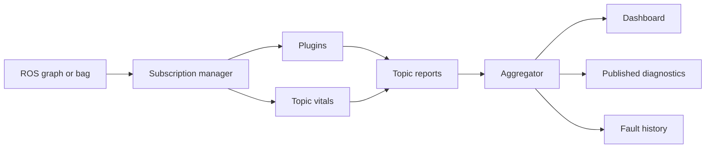

# Architecture

Testudo observes a stack from outside and needs no changes to the nodes it watches.

| Stage | Module | Responsibility |
|---|---|---|
| Discovery | `core/discovery.py` | Lists the graph and matches each publisher's QoS |
| Subscriptions | `core/subscription_manager.py`, `core/tier_subscription.py` | Chooses each topic's [tier](../concepts/tiers.md) and delivers messages |
| Checks | `plugins/builtin/` | Turn messages into a `CheckStatus` |
| Reports | `core/topic_report.py`, `core/report_builder.py` | Join a plugin's status with liveness and stamps |
| Aggregation | `core/aggregator.py` | Debounces severities and rolls up the verdict |
| Fault history | `core/fault_history.py` | Records faults as they are raised and cleared |
| Output | `core/publisher.py`, `core/live_output.py` | Publishes the diagnostics |
| Dashboard | `tui/` | Draws reports, and knows nothing about how they were decided |
| Replay | `core/replay.py`, `core/replay_timeline.py` | Runs the same pipeline over a bag |

## Threads

One lock in the subscription manager is held for each message, tick, poll and rediscovery. Plugins therefore never have to be thread-safe. A plugin that raises is caught at that boundary and reported as [`CHECK-001`](../core-checks/check.md#check-001).

## Sampling and publishing

Content checks run at `max_check_rate_hz`, and reports are published at `publish.rate_hz`. The two are independent, so a 200 Hz topic doesn't publish diagnostics 200 times a second.
