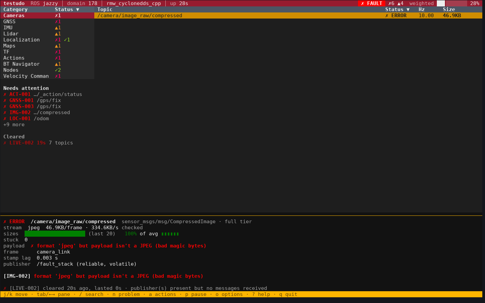

# Getting started

Install Testudo, point it at a running stack, and read your first diagnosis. You don't need a config file.

## 1. Install

Testudo is a colcon package for ROS 2 Jazzy.

```bash
cd ~/your_ws/src
git clone https://github.com/mlisi1/testudo.git
cd ~/your_ws
rosdep install --from-paths src --ignore-src -r -y
pip install textual   # rosdep's python3-textual is too old for the dashboard
colcon build --packages-select testudo
source install/setup.bash
```

Check that it works. This lists every check and the message types it covers:

```bash
testudo plugins
```

??? note "Optional packages"
    `nav2_msgs` is needed only for the [behavior tree log](../plugins/bt-log.md). GPU memory readings need an NVIDIA card and `pynvml`.

## 2. Watch your stack

With your stack running, in a terminal on the same `ROS_DOMAIN_ID`:

=== "Real robot"

    ```bash
    testudo watch
    ```

=== "Simulator"

    ```bash
    testudo watch --ros-args -p use_sim_time:=true
    ```

=== "No stack at hand"

    The repository includes a small node that misbehaves on purpose. It needs `nav2_msgs`. Run each command in its own terminal:

    ```bash
    python3 ~/your_ws/src/testudo/docs/gen/media/fault_stack.py
    ```

    ```bash
    testudo watch -c ~/your_ws/src/testudo/docs/gen/media/fault_config.yaml
    ```

Every topic a plugin covers gets its content checks straight away.

## 3. Read the diagnosis



1. **Top bar:** the overall verdict, from `✓ NOMINAL` to `✗ FAULT`.
2. **Left:** one row per category. Below them, **Needs attention** lists the active codes, worst first.
3. **Right:** every topic in the highlighted category.
4. **Bottom:** the highlighted topic's values, and what each active code means.

Press ++n++ to jump to the next problem, ++question++ for every key, and ++q++ to quit.

!!! tip "What does a code mean?"
    Each code, such as [`IMU-005`](../plugins/imu.md#imu-005), has an entry with its likely causes and what to do. [All codes](../reference/codes.md) lists them in one place.

## Where to go next

<div class="grid cards" markdown>

-   :material-robot-industrial:{ .lg .middle } **[Bring up a robot](bring-up.md)**

    ---

    Work through the problems and tune the checks for your hardware.

-   :material-history:{ .lg .middle } **[Investigate a bag](replay.md)**

    ---

    Find what broke first in a recorded run.

-   :material-cog-outline:{ .lg .middle } **[Write a config](config-init.md)**

    ---

    Declare what must be there and unlock more checks.

-   :material-test-tube:{ .lg .middle } **[Use it in CI](ci.md)**

    ---

    Fail a pipeline when a simulated run goes wrong.

</div>
