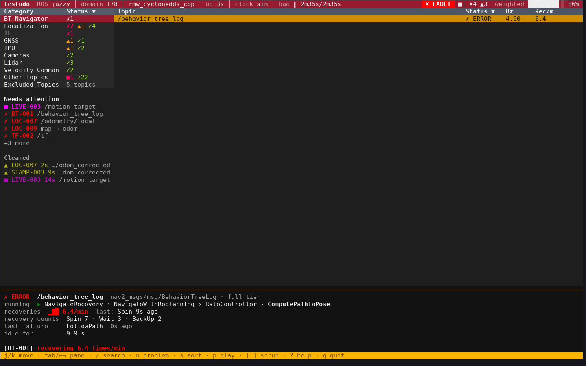

# Investigate a bag

Testudo runs the same checks over a recorded bag, without playing it onto the ROS graph. Start with the report, then open the moment that matters.

## 1. Read the report

```bash
testudo replay my_bag/
```

This prints each topic's final status and a **Faults during the bag** section. Faults are sorted by when they were raised, so the first ones are usually closest to the cause.

## 2. Scrub through the run

```bash
testudo replay --watch my_bag/
```



The dashboard opens paused on the last frame.

| Key | Action |
|---|---|
| ++p++ | Play or pause, at bag speed |
| ++bracket-left++ ++bracket-right++ | Back or forward one frame |
| ++brace-left++ ++brace-right++ | Back or forward ten frames |
| ++n++ | Next topic with a problem at this moment |

Step to the time of the first fault, then use ++n++ to see what else was wrong at that moment.

!!! note "Short faults"
    The dashboard samples a bag at least 1 s apart, with at most 600 frames, so a very short fault can fall between two frames. The report from step 1 still lists it.

## Use the robot's config

Pass the robot's config, so levels and declared topics match what you run live:

```bash
testudo replay -c robot_config.yaml my_bag/
```

Node profiling isn't available in a replay, because a bag has no processes to sample.
