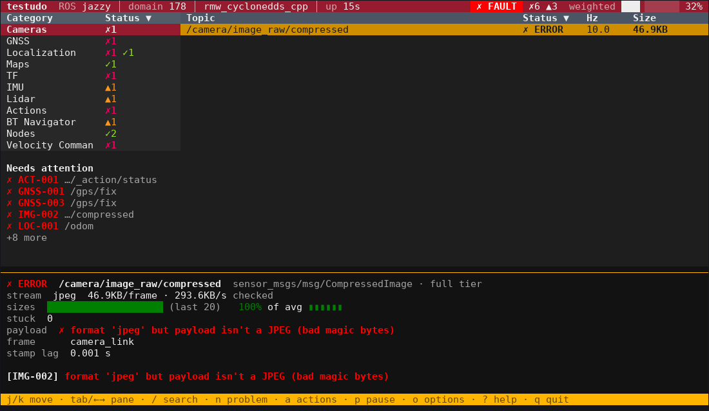

<figure class="tx-anatomy">

<b style="right:40%">1</b>
<b>2</b>
<b>3</b>
<b>4</b>
<b>5</b>
<b>6</b>
<b>7</b>

<figcaption>
<ol class="tx-legend">
<li><strong>Status Bar.</strong> The verdict for the whole stack, at the right end. Start here.</li>
<li><strong>Categories.</strong> Topics grouped by what they are, with a count per severity.</li>
<li><strong>Needs attention.</strong> What's wrong right now, worst first. Problems that went away are listed below it, under <strong>Cleared</strong>.</li>
<li><strong>Topics.</strong> Every topic in the highlighted category, with its status and rate.</li>
<li><strong>Details.</strong> Everything Testudo knows about the highlighted topic.</li>
<li><strong>Active codes.</strong> What's wrong on this topic. Every code is explained in these docs.</li>
<li><strong>Hint bar.</strong> The main keys. Press <kbd>?</kbd> to see them all.</li>
</ol>
</figcaption>
</figure>
