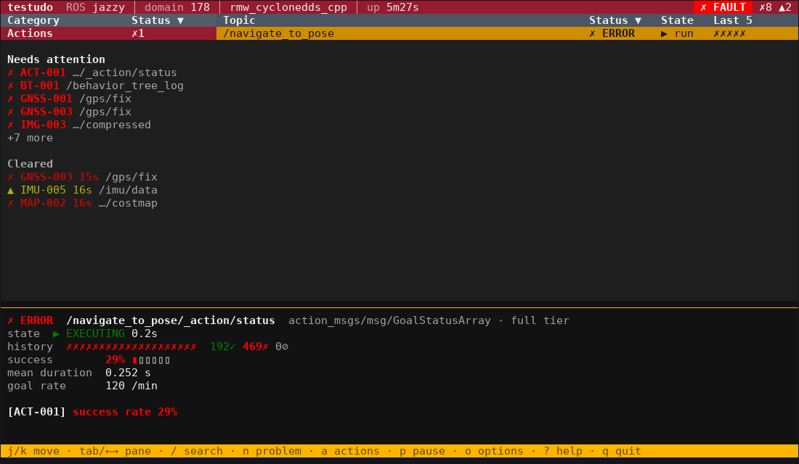

# Actions

Tracks how the goals of any ROS 2 action server end, from its status topic.

<video class="tx-loop" src="../../assets/media/plugins/actions.mp4" autoplay loop muted playsinline disablepictureinpicture disableremoteplayback preload="metadata" aria-label="An action server whose goals start aborting"></video>
<p class="tx-caption" markdown="span">Goals start aborting, and [`ACT-001`](#act-001) follows the success rate down.</p>

## What it covers

| | |
|---|---|
| Message types | `action_msgs/msg/GoalStatusArray` |
| Tier | Full, declared or not. Every message is read |
| TUI category | Actions |
| Published on | `/testudo/actions` |

## What it needs

Every action server already publishes this status topic. Declaring the action lets you tune it, and its feedback topic adds the remaining distance and time when the action reports them:

```yaml
actions:
  - name: navigate_to_pose
    related_topics:
      feedback: /navigate_to_pose/_action/feedback
    thresholds:
      success_rate: {warn: 0.9}
```

### How goals are counted

| Outcome | Counts as |
|---|---|
| Succeeded | Success |
| Aborted | Failure |
| Aborted while a newer goal of the same server is active | Canceled: Nav2 reports a replaced goal this way |
| Canceled | Neither, because canceling is someone's decision |

## Codes

### ACT-001 · Low success rate { #act-001 }

<span class="sev sev-warn">▲ WARN</span> <span class="sev sev-error">✗ ERROR</span> Succeeded goals out of succeeded plus aborted are below `success_rate`. The rate covers the whole session, so it stays low until enough goals succeed or stats are reset with ++r++.

**Likely causes:** unreachable goals, planner or controller failures.

**What to do:** look at the behavior tree and the servers it calls at the moment the goal failed.

### ACT-002 · Goals taking too long { #act-002 }

<span class="sev sev-warn">▲ WARN</span> <span class="sev sev-error">✗ ERROR</span> The mean duration of the recent goals is past `avg_duration_s`. It has no default, because a sensible duration depends on the action.

**Likely causes:** a slow robot, long routes, or repeated recoveries.

**What to do:** set a level that suits this action, then compare with the [behavior tree log](bt-log.md).

### ACT-003 · Action invoked too often { #act-003 }

<span class="sev sev-warn">▲ WARN</span> <span class="sev sev-error">✗ ERROR</span> Goals are accepted more often than `frequency_per_min`. It has no default. On a recovery action such as `spin`, a high rate usually means the planner keeps getting stuck.

**Likely causes:** repeated recoveries or a client resending goals.

**What to do:** find what keeps sending the goals.

## Settings

--8<-- "levels/actions.md"

## In the TUI



The Topic Panel adds a `Last 5` column with the latest outcomes. The Detail Panel shows the current state, outcome history, success rate and durations.

## Known limits

- A goal's result is not read, since fetching it would mean calling a service and Testudo only observes. So the reason a goal failed isn't shown.
- Goals rejected before acceptance never appear on the status topic.
