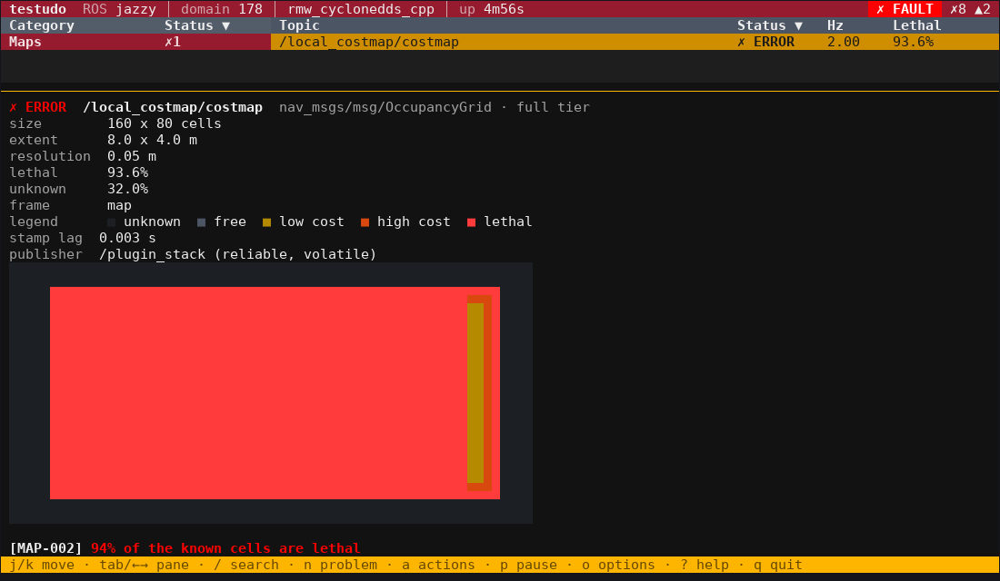

# Costmap

Checks occupancy grids, both static maps and costmaps, and draws them in the terminal.

<video class="tx-loop" src="../../assets/media/plugins/costmap.mp4" autoplay loop muted playsinline disablepictureinpicture disableremoteplayback preload="metadata" aria-label="A costmap filling up with lethal cells"></video>

Obstacles sweep across the grid until [`MAP-002`](#map-002) fires. The map is drawn in the Detail Panel.

## What it covers

| | |
|---|---|
| Message types | `nav_msgs/msg/OccupancyGrid` |
| Tier | Full, declared or not |
| TUI category | Maps |
| Published on | `/testudo/costmap` |

## What it needs

Nothing. When `<topic>_updates` exists, the plugin follows it by convention, and the full grid may stay silent while updates keep arriving.

Obstacles that stay in a costmap are never a fault, because not clearing them can be what you configured.

## Codes

### MAP-001 · Empty or malformed grid { #map-001 }

✗ ERROR The grid has no cells, an invalid resolution, or a data length that doesn't match its size.

**Likely causes:** a map server without a map, or a publisher filling the message inconsistently.

**What to do:** the code's message says which of these happened.

### MAP-002 · Too much of the grid is lethal { #map-002 }

▲ WARN ✗ ERROR More than `lethal_ratio` of the known cells are lethal.

**Likely causes:** sensor noise marked as obstacles, a robot footprint inside the grid, or a very tight space.

**What to do:** look at the picture in the Detail Panel. Raise `warn` where a corridor is legitimately mostly obstacles.

### MAP-003 · Grid is nearly blank { #map-003 }

▲ WARN ✗ ERROR More than `unknown_ratio` of the grid is unknown. The default levels are high, because a static map is mostly unknown around the building and a mapless costmap is mostly unknown beyond the sensors' reach.

**Likely causes:** no sensor data reaching the costmap, or an empty map.

**What to do:** check the costmap's observation sources.

### MAP-004 · Grid size or resolution changed { #map-004 }

▲ WARN The width, height or resolution differs from the previous full grid. The code stays active for 10 s. A map being built (SLAM) grows by changing size, so once a grid has resized, later size changes aren't reported; a resolution change always is.

**Likely causes:** a new map loaded, or a reconfigured costmap.

**What to do:** confirm the change was intended.

### MAP-005 · Update doesn't fit the grid { #map-005 }

▲ WARN An incremental update falls outside the grid, or its data length doesn't match its size. The code stays active for 10 s.

**Likely causes:** an update applied to a grid that has since changed size.

**What to do:** check the publisher of `<topic>_updates`.

## Settings

--8<-- "levels/costmap.md"

## In the TUI

The Topic Panel adds a `Lethal` column. The Detail Panel draws the grid in half blocks, keeping walls visible when it is scaled down.

## Known limits

- No robot is drawn on the picture, because Testudo can't know which topic holds the right pose.
- The picture and the cell counts refresh at most once per second.
