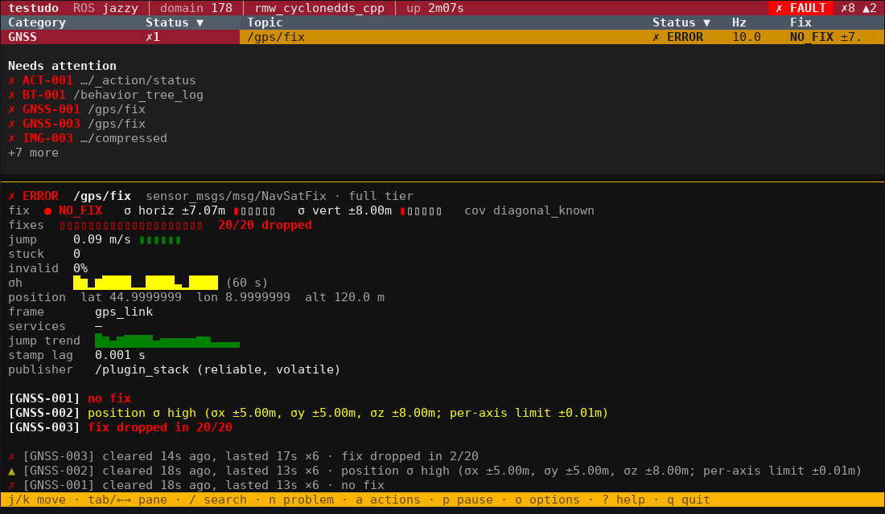

# GNSS

Checks a receiver's fix: whether it has one, how accurate it claims to be, and whether its positions are believable.

<video class="tx-loop" src="../../assets/media/plugins/gnss.mp4" autoplay loop muted playsinline disablepictureinpicture disableremoteplayback preload="metadata" aria-label="A GNSS receiver losing its fix"></video>
<p class="tx-caption" markdown="span">The receiver loses its fix and its claimed accuracy collapses: [`GNSS-001`](#gnss-001) and [`GNSS-002`](#gnss-002).</p>

## What it covers

| | |
|---|---|
| Message types | `sensor_msgs/msg/NavSatFix` |
| Tier | Full, declared or not |
| TUI category | GNSS |
| Published on | `/testudo/gnss` |

## What it needs

No related topics. The default covariance level is RTK-grade, so a consumer or SBAS receiver should raise it:

```yaml
topics:
  sensor_msgs/msg/NavSatFix:
    - name: /gps/fix
      thresholds:
        position_covariance: {warn: 1.0}
```

## Codes

### GNSS-001 · No fix { #gnss-001 }

<span class="sev sev-error">✗ ERROR</span> The latest message reports `STATUS_NO_FIX`.

**Likely causes:** no sky view, an antenna problem, or a receiver still starting.

**What to do:** check the antenna and sky view. Where losing the fix is expected, downgrade it with `codes: {GNSS-001: warn}`.

### GNSS-002 · Position uncertainty too high { #gnss-002 }

<span class="sev sev-warn">▲ WARN</span> <span class="sev sev-error">✗ ERROR</span> The variance of at least one axis is past `position_covariance`. Each axis is judged separately, so a bad vertical fix can't hide behind good horizontal ones. It is skipped when the driver reports `COVARIANCE_TYPE_UNKNOWN`.

**Likely causes:** poor satellite geometry, multipath, or a level meant for another receiver grade.

**What to do:** compare the reported σ with what your receiver should achieve, then tune the level.

### GNSS-003 · Fix dropping out { #gnss-003 }

<span class="sev sev-warn">▲ WARN</span> <span class="sev sev-error">✗ ERROR</span> More than `fix_dropout_ratio` of the last 20 checked messages had no fix.

**Likely causes:** bridges, tree canopy or a marginal antenna.

**What to do:** review the route and the antenna placement.

### GNSS-004 · Implausible position jump { #gnss-004 }

<span class="sev sev-warn">▲ WARN</span> <span class="sev sev-error">✗ ERROR</span> Two consecutive real fixes imply a speed above `jump_speed_mps`. Fixes around a dropout are not compared.

**Likely causes:** multipath, or the receiver switching correction source.

**What to do:** check whether the estimator using this fix rejected the jump.

### GNSS-005 · Fix stuck { #gnss-005 }

<span class="sev sev-warn">▲ WARN</span> <span class="sev sev-error">✗ ERROR</span> Latitude, longitude and altitude have been identical for more consecutive checked messages than `stuck_count` allows.

**Likely causes:** a frozen driver republishing its last fix.

**What to do:** restart the driver and check the link to the receiver.

### GNSS-006 · NaN or Inf in the position { #gnss-006 }

<span class="sev sev-warn">▲ WARN</span> <span class="sev sev-error">✗ ERROR</span> More than `invalid_ratio` of latitude, longitude and altitude is not finite.

**Likely causes:** a driver publishing before the first fix, or a parsing fault.

**What to do:** check whether it clears once the receiver has a fix.

### GNSS-007 · Frame id changed { #gnss-007 }

<span class="sev sev-warn">▲ WARN</span> `header.frame_id` differs from an earlier message on this topic. It stays active until stats are reset with ++r++.

**Likely causes:** two publishers on one topic, or a reconfigured driver.

**What to do:** check how many nodes publish the topic.

## Settings

--8<-- "levels/gnss.md"

## In the TUI



The Topic Panel adds a `Fix` column. The Detail Panel shows the fix type, position, per-axis σ and recent trends.

## Known limits

- Default levels other than the fix itself are first estimates and have not yet been validated on a real robot.
- A receiver that reports a good covariance for a bad position can't be detected from this message alone.
