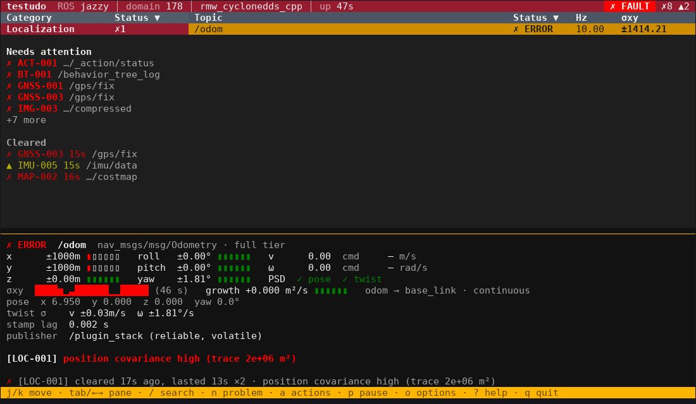

# Localization

Judges a pose estimate by what its frame says about it: odometry may drift but must never jump, and a global pose may jump but must not lose confidence.

<video class="tx-loop" src="../../assets/media/plugins/localization.mp4" autoplay loop muted playsinline disablepictureinpicture disableremoteplayback preload="metadata" aria-label="Odometry whose position covariance becomes a placeholder"></video>
<p class="tx-caption" markdown="span">The position variance jumps to a placeholder value, and [`LOC-001`](#loc-001) fires until the estimate recovers.</p>

## What it covers

| | |
|---|---|
| Message types | `nav_msgs/msg/Odometry`, `geometry_msgs/msg/PoseWithCovarianceStamped` |
| Tier | Full, declared or not |
| TUI category | Localization |
| Published on | `/testudo/localization` |

### Frame roles

The role comes from the last segment of `header.frame_id`, so `robot1/map` counts as `map`.

| Role | Frames | Covariance | Jumps | Silence |
|---|---|---|---|---|
| Continuous | `odom` | May grow; only a placeholder-sized value is a fault | Any jump is a bug | Always a fault |
| Global | `map`, `earth` | Growing means localization is being lost | Relocalizing is normal; large ones and bursts are flagged | A pose message may go quiet at rest |
| Unknown | Anything else | Strict defaults | Strict defaults | Always a fault |

Set `frame_role: continuous` or `frame_role: global` on a topic whose frame says neither.

## What it needs

Nothing, for the core checks. One optional related topic adds more:

| Related topic | Adds |
|---|---|
| `cmd_vel` | [`LOC-006`](#loc-006), and turns a pose topic's silence into STALE after 10 s of being told to move |

```yaml
topics:
  nav_msgs/msg/Odometry:
    - name: /odom
      related_topics:
        cmd_vel: /cmd_vel
  geometry_msgs/msg/PoseWithCovarianceStamped:
    - name: /amcl_pose
      related_topics:
        cmd_vel: /cmd_vel
```

## Codes

### LOC-001 · Position covariance too high { #loc-001 }

<span class="sev sev-warn">▲ WARN</span> <span class="sev sev-error">✗ ERROR</span> The sum of the x, y and z position variances is past `position_covariance_trace`.

**Likely causes:** a filter that has lost its inputs, or a driver publishing a placeholder such as `1e6` on the diagonal.

**What to do:** check the sources feeding the estimate. On a continuous topic only the placeholder-sized `error` level applies, because wheel odometry grows without bound.

### LOC-002 · Yaw variance too high { #loc-002 }

<span class="sev sev-warn">▲ WARN</span> <span class="sev sev-error">✗ ERROR</span> The yaw variance is past `yaw_variance`.

**Likely causes:** no heading source reaching the filter, or a placeholder value.

**What to do:** confirm the IMU or other heading input is fused and that its covariance is realistic.

### LOC-003 · Covariance growing { #loc-003 }

<span class="sev sev-warn">▲ WARN</span> <span class="sev sev-error">✗ ERROR</span> The position covariance trace is changing faster than `covariance_growth_rate`, in m²/s, across the last 10 messages. Continuous topics have no default level for this.

**Likely causes:** a global localizer no longer receiving corrections.

**What to do:** check the measurements the localizer depends on, such as the scan or GNSS input.

### LOC-004 · Pose covariance is not positive semi-definite { #loc-004 }

<span class="sev sev-error">✗ ERROR</span> The 6×6 pose covariance is not a valid covariance matrix.

**Likely causes:** a filter that has diverged, or a matrix filled in by hand with inconsistent off-diagonal terms.

**What to do:** inspect the matrix on the topic. Consumers such as sensor fusion can fail on it.

### LOC-005 · Twist covariance is not positive semi-definite { #loc-005 }

<span class="sev sev-error">✗ ERROR</span> The 6×6 twist covariance of an `Odometry` message is not a valid covariance matrix.

**Likely causes:** the same as [`LOC-004`](#loc-004), on the velocity half of the message.

**What to do:** inspect the twist covariance published by the odometry source.

### LOC-006 · Commanded to move, odometry reports no motion { #loc-006 }

<span class="sev sev-warn">▲ WARN</span> `cmd_vel` asks for more than 0.05 m/s or 0.05 rad/s while odometry reports at most 0.02 of each. It applies to `Odometry` with a `cmd_vel` related topic, and never on a global topic.

**Likely causes:** motors disabled, an emergency stop, a blocked robot, or odometry that has stopped updating.

**What to do:** check the base driver. [`VEL-002`](velocity-command.md#vel-002) reports the same situation over time, on the command topic.

### LOC-007 · Pose jumped { #loc-007 }

<span class="sev sev-warn">▲ WARN</span> <span class="sev sev-error">✗ ERROR</span> The pose moved further than its reported motion explains. Continuous and unknown frames use `pose_jump_m` and `pose_jump_rad`, and global frames use `global_pose_jump_m` and `global_pose_jump_rad`. The code stays active for 10 s after the jump.

**Likely causes:** a bad measurement accepted by the filter, a sensor dropout, or a restarted estimator.

**What to do:** look at what happened to the estimator's inputs at the moment of the jump.

### LOC-008 · Too many relocalizations { #loc-008 }

<span class="sev sev-warn">▲ WARN</span> <span class="sev sev-error">✗ ERROR</span> A global topic corrected itself by 0.5 m or more more often in the last minute than `relocalizations_per_min` allows.

**Likely causes:** a map that doesn't match the environment, or a localizer alternating between two hypotheses.

**What to do:** compare the scan with the map where the robot is.

### LOC-009 · `map → odom` jumped { #loc-009 }

<span class="sev sev-warn">▲ WARN</span> <span class="sev sev-error">✗ ERROR</span> The `map → odom` transform changed by more than `map_odom_jump_m` or `map_odom_jump_rad` between two updates. It appears on its own `map → odom` row and stays active for 10 s.

**Likely causes:** the global localizer jumping, even on a stack that publishes no pose topic.

**What to do:** check the localizer. Tune this code under a `/tf` entry, because the row is worked out from `/tf`:

```yaml
topics:
  tf2_msgs/msg/TFMessage:
    - name: /tf
      thresholds:
        map_odom_jump_m: {warn: 1.0}
```

## Settings

These are the defaults for a frame with no known role, plus the jump levels:

--8<-- "levels/localization.md"

A metric left at its default follows the role instead:

=== "Continuous"

    --8<-- "levels/localization-continuous.md"

=== "Global"

    --8<-- "levels/localization-global.md"

The `map → odom` levels are listed on the [TF watch page](tf-watch.md#settings). Anything you write in the config wins over both tables.

## In the TUI



The Topic Panel adds a `σxy` column. The Detail Panel shows the pose, per-axis σ meters, and actual against commanded velocity.

## Known limits

- Default levels and jump limits are first estimates and have not yet been validated on a real robot.
- Without a `cmd_vel` related topic, a pose topic's silence is always treated as the robot being at rest.
- An `Odometry` message in `map` is expected to keep publishing, so its silence is a fault.
