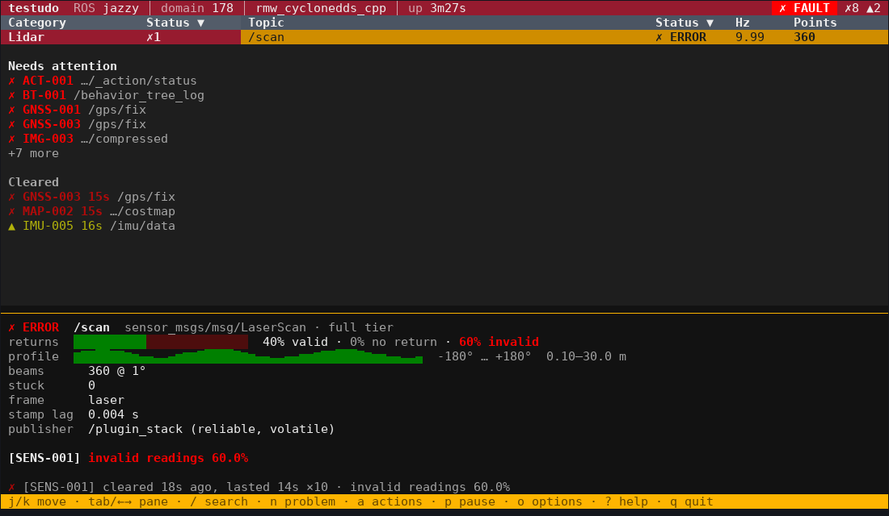

# Point stream

Checks 2D and 3D range sensors: whether their readings are valid, changing and well formed.

<video class="tx-loop" src="../../assets/media/plugins/point-stream.mp4" autoplay loop muted playsinline disablepictureinpicture disableremoteplayback preload="metadata" aria-label="A laser scan whose readings turn invalid"></video>
<p class="tx-caption" markdown="span">Most of the scan turns to NaN, and [`SENS-001`](#sens-001) fires.</p>

## What it covers

| | |
|---|---|
| Message types | `sensor_msgs/msg/LaserScan`, `sensor_msgs/msg/PointCloud2` |
| Tier | `LaserScan`: full, declared or not. `PointCloud2`: **presence unless declared** |
| TUI category | Lidar |
| Published on | `/testudo/point_stream` |

## What it needs

Declare a point cloud to check its content, since a dense cloud is expensive to subscribe to:

```yaml
topics:
  sensor_msgs/msg/PointCloud2:
    - name: /velodyne_points
```

## Codes

### SENS-001 · Invalid readings { #sens-001 }

<span class="sev sev-warn">▲ WARN</span> <span class="sev sev-error">✗ ERROR</span> More than `invalid_ratio` of the readings are invalid. In a scan these are NaN, −Inf and values outside `range_min..range_max`; +Inf is a valid "nothing in range" under REP 117. In a cloud with `is_dense: false`, NaN is a beam with no return and only Inf counts as invalid.

**Likely causes:** a dirty sensor, rain or dust, or a driver fault.

**What to do:** look at the sensor window. A rough outdoor lidar may need a higher `warn`.

### SENS-002 · Readings stuck { #sens-002 }

<span class="sev sev-warn">▲ WARN</span> <span class="sev sev-error">✗ ERROR</span> The scan or cloud has been identical for more consecutive checked messages than `stuck_count` allows.

**Likely causes:** a frozen driver republishing its last message.

**What to do:** restart the driver and check the sensor's connection.

### SENS-003 · All-zero scan { #sens-003 }

<span class="sev sev-warn">▲ WARN</span> Every range in a `LaserScan` is exactly zero.

**Likely causes:** a sensor that isn't spinning or hasn't started.

**What to do:** check the sensor's power and the driver's log.

### SENS-004 · Ranges outside the sensor's limits { #sens-004 }

<span class="sev sev-warn">▲ WARN</span> A `LaserScan` holds finite ranges outside its own `range_min..range_max`.

**Likely causes:** wrong limits in the driver's configuration.

**What to do:** correct `range_min` and `range_max`, since consumers discard or misread these readings.

### SENS-005 · Frame id changed { #sens-005 }

<span class="sev sev-warn">▲ WARN</span> `header.frame_id` differs from an earlier message on this topic. It stays active until stats are reset with ++r++.

**Likely causes:** two publishers on one topic, or a reconfigured driver.

**What to do:** check how many nodes publish the topic.

### SENS-006 · Empty point cloud { #sens-006 }

<span class="sev sev-error">✗ ERROR</span> A `PointCloud2` has no data or no points.

**Likely causes:** a sensor or filter producing nothing.

**What to do:** check the driver, then each filter between it and this topic.

### SENS-007 · Malformed point cloud { #sens-007 }

<span class="sev sev-error">✗ ERROR</span> A `PointCloud2` declares a non-positive size, or holds less data than `height × row_step`.

**Likely causes:** a publisher filling the message's fields inconsistently.

**What to do:** fix the publisher, since consumers can read past the end of the data.

## Settings

--8<-- "levels/point-stream.md"

## In the TUI



The Topic Panel adds a `Points` column. The Detail Panel shows the share of valid, no-return and invalid readings, plus a scan profile for a `LaserScan`.

## Known limits

- Only `x`, `y` and `z` are checked in a cloud. Intensity, color and ring fields are ignored.
- Geometry is not judged: a valid scan of the wrong place reads as healthy.
