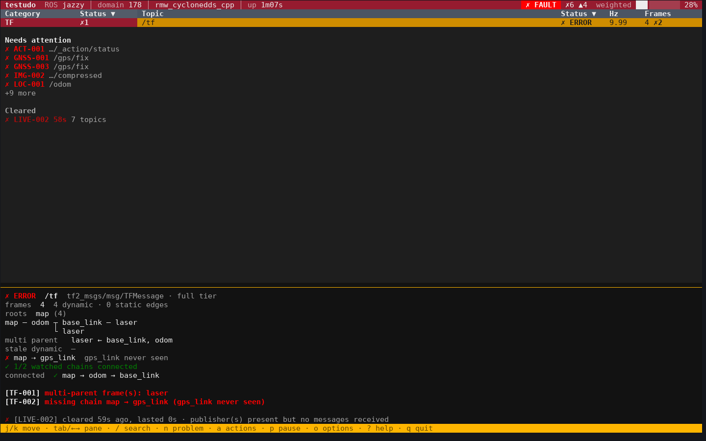

# TF watch

Checks the transform tree: that it is valid, connected where you need it, and still being updated.



## What it covers

| | |
|---|---|
| Message types | `tf2_msgs/msg/TFMessage`, on `/tf` together with `/tf_static` |
| Tier | Full, declared or not. Every message is read |
| TUI category | TF |
| Published on | `/testudo/tf_watch` |

It also works out the `map → odom` row shown in the Localization category. See [`LOC-009`](localization.md#loc-009).

## What it needs

List the frame pairs that must stay connected under `tf:`. Without any, [`TF-002`](#tf-002) has nothing to check.

```yaml
tf:
  - {parent: map, child: odom}
  - {parent: odom, child: base_link}
```

## Codes

### TF-001 · Frame with more than one parent { #tf-001 }

<span class="sev sev-error">✗ ERROR</span> A child frame has been published with two different parents, which makes the tree invalid.

**Likely causes:** two nodes publishing the same transform, such as both an EKF and a driver publishing `odom → base_link`.

**What to do:** keep one publisher for that child frame.

### TF-002 · Declared chain missing { #tf-002 }

<span class="sev sev-error">✗ ERROR</span> A pair listed under `tf:` is not connected. The code's message says whether a frame was never seen or the two are in separate trees.

**Likely causes:** a node that hasn't started, or a missing static transform.

**What to do:** the Detail Panel shows the tree and each watched chain.

### TF-003 · Dynamic transforms stopped updating { #tf-003 }

<span class="sev sev-warn">▲ WARN</span> A transform seen on `/tf` hasn't been updated for more than 10 s, the default length of tf2's buffer. Lookups through it will soon fail with extrapolation errors. Transforms on `/tf_static` never age.

**Likely causes:** a crashed broadcaster.

**What to do:** find the node publishing that edge.

## Settings

These levels belong to the [`LOC-009`](localization.md#loc-009) row:

--8<-- "levels/tf-watch.md"

## In the TUI

The Topic Panel adds a `Frames` column. The Detail Panel shows the frame tree and each watched chain.

## Known limits

- Staleness approximates tf2's extrapolation errors without running a real tf2 buffer.
- Connectivity follows every transform seen in this session, so a stopped transform still counts as connected.
