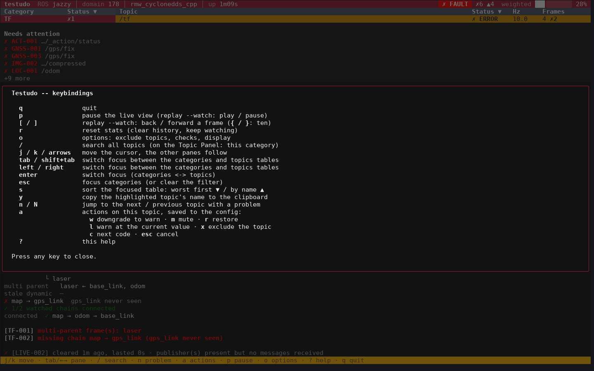

# Keys

Press ++question++ in the dashboard to see this list at any time.

| Key | Action |
|---|---|
| ++q++ | Quit |
| ++question++ | Help |
| ++j++ / ++k++ / arrows | Move the cursor. The other panes follow |
| ++tab++ / ++shift+tab++ | Switch between the categories and topics tables |
| ++left++ / ++right++ | Switch between the categories and topics tables |
| ++enter++ | Switch between the categories and topics tables |
| ++esc++ | Focus categories, or clear the filter |
| ++slash++ | Search all topics. On the Topic Panel, filter this category |
| ++n++ / ++shift+n++ | Next or previous topic with a problem |
| ++s++ | Sort the focused table: worst first or by name |
| ++y++ | Copy the highlighted topic's name |
| ++a++ | [Quick actions](quick-actions.md) on this topic |
| ++o++ | [Options](options.md) |
| ++p++ | Pause the display. Checks and publishing continue |
| ++r++ | Reset stats and fault history, keeping subscriptions |

## In `replay --watch`

| Key | Action |
|---|---|
| ++p++ | Play or pause, at bag speed |
| ++bracket-left++ / ++bracket-right++ | Back or forward one frame |
| ++brace-left++ / ++brace-right++ | Back or forward ten frames |
