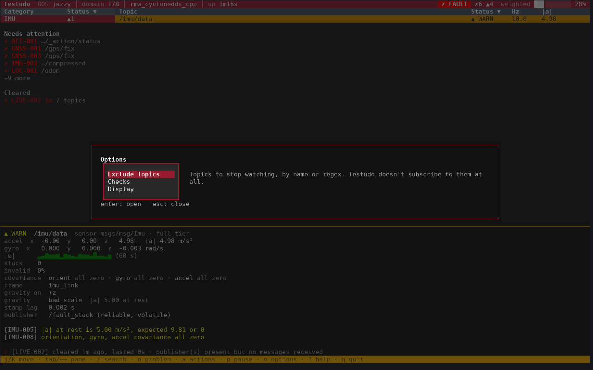

# Options

Press ++o++ to open the menu. ++esc++ goes back.

## Exclude Topics

Lists the active rules. Press ++a++ to add one and ++d++ to delete the selected one. Prefix a pattern with `regex:` to use a regex. The preview shows how many visible topics a rule would match before you submit it.

## Checks

Saved to the robot's config. Press ++enter++ or ++space++ to move a setting to its next value.

| Setting | Config key |
|---|---|
| Severity mode | `severity_mode` |
| Check rate | `max_check_rate_hz` |
| Debounce samples | `debounce_samples` |
| Fault retention | `faults.retention` |
| Node profiling | `node_profiling.enabled` |
| GPU memory | `node_profiling.gpu_enabled` |

Node profiling that was off when Testudo started begins on the next run. A replay has no Checks section.

## Display

Saved per user in `display.yaml`, never in the robot's config.

| Setting | Meaning |
|---|---|
| Refresh rate | How often the dashboard redraws. Checks and publishing aren't affected |
| Default sort | Worst first or by name |
| Hide OK topics | Show only topics with problems |
| Show Nodes | Show the Nodes category |
