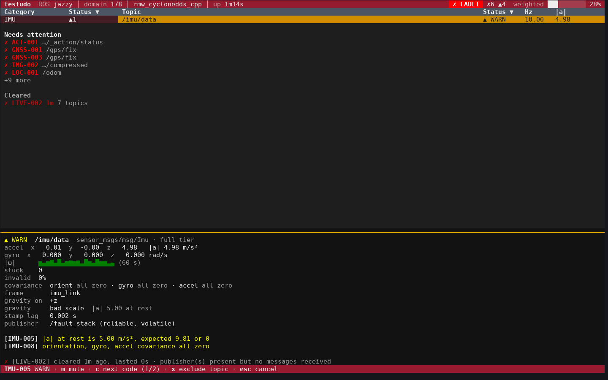

# Quick actions

Press ++a++ on a topic in a live session. Its actions replace the hint bar for one keypress.

| Key | Action |
|---|---|
| ++w++ | Downgrade the code to WARN |
| ++m++ | Mute the code |
| ++l++ | Set the `warn` level of the metric behind the code from its current value |
| ++r++ | Restore a code you overrode |
| ++c++ | Go to the next code on this topic |
| ++x++ | Exclude the topic |
| ++esc++ | Cancel |

Each action takes effect at once and is saved to the loaded config, declaring the topic there if needed. If saving fails, the change lasts for this session and the dashboard says so.

++l++ rounds the value to three significant digits towards the worse side, so the current reading stays good. It isn't offered once the value is past the `error` level, which only you can move in the config.

A muted code stays listed here, so you can always restore it.
