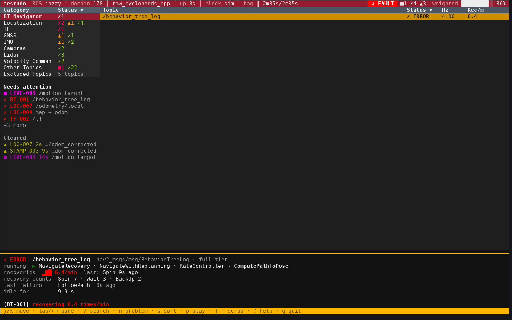

# Replay scrubbing

`testudo replay --watch my_bag/` first processes the whole bag, then opens the dashboard paused on the last frame.

The Status Bar shows the position, such as `bag ▶ 1m42s/2m35s`. Press ++p++ to play at bag speed. Playing from the end starts again from the beginning.

Frames are at least 1 s apart, and a bag has at most 600 of them, so a one-hour bag has one frame every 6 s. A fault shorter than that can fall between two frames, but the batch report made by `testudo replay` lists it.

[Quick actions](quick-actions.md) and node profiling aren't available in a replay.
